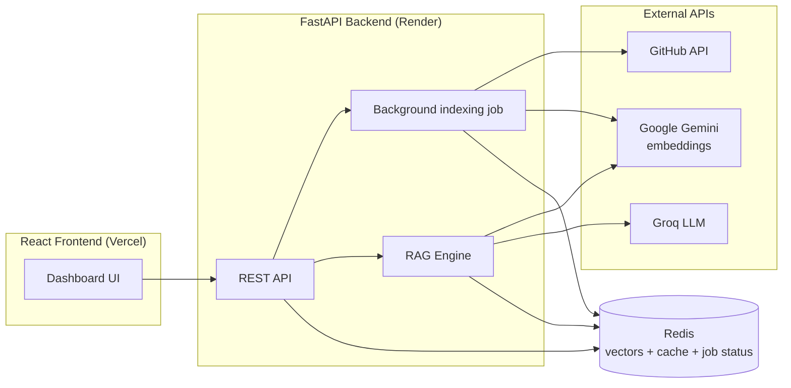
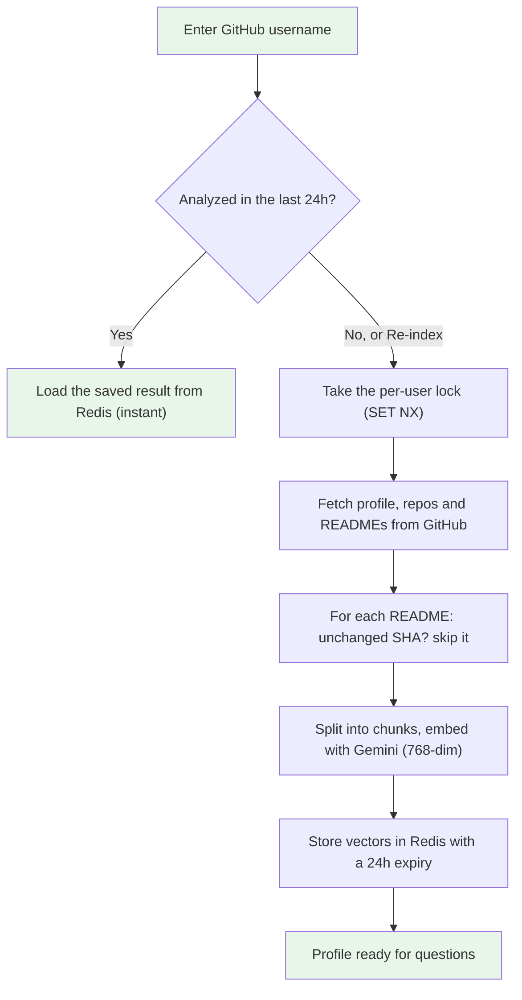
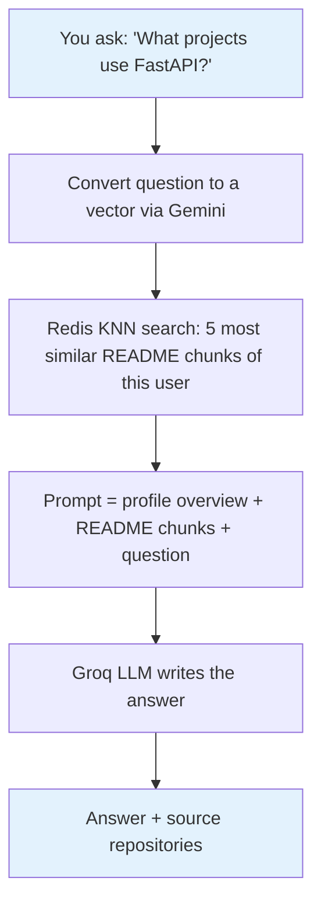
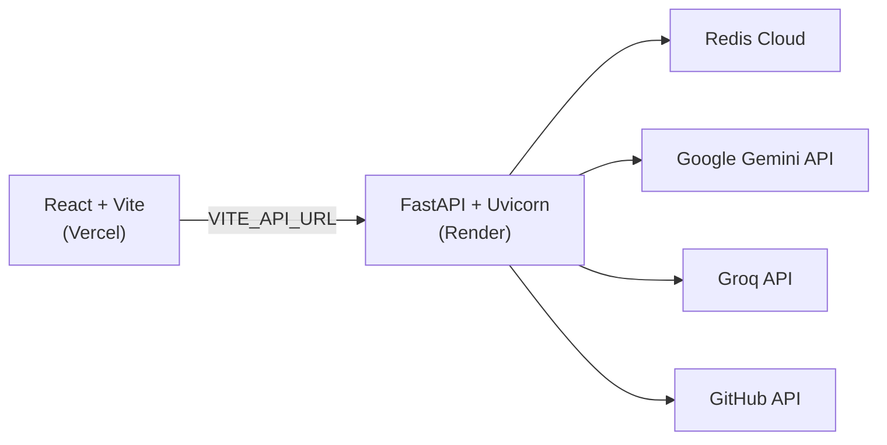
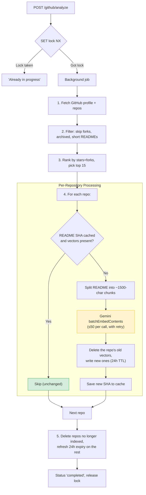
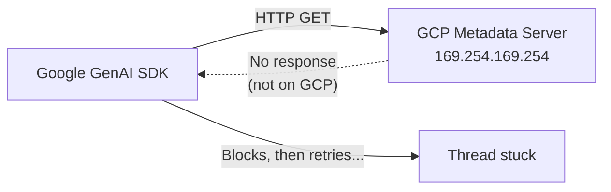

# RedisRAG — AI-Powered GitHub Profile Analyzer

> Analyze any GitHub developer's profile and have an AI conversation about their projects, powered by Retrieval-Augmented Generation (RAG).

**Live demo:** https://redis-rag.vercel.app (the free backend sleeps when idle, so the first request can take up to a minute)

RedisRAG fetches public repositories, reads their README files, converts them into vector embeddings using **Google Gemini**, stores those vectors in **Redis**, and lets you ask questions about the developer's work. When you ask a question, the system searches Redis for the most relevant README snippets and sends them, together with a short overview of the whole profile, to an LLM on **Groq** to generate a grounded answer with source citations.

There is no login: open the site, type a GitHub username, and start asking.

---

## How It Works (The Big Picture)



Two paths go through the backend:

- **Write path (indexing)** — slow, because it calls GitHub and Gemini. It runs as a background job; the API answers `202 Accepted` right away and the frontend polls for progress.
- **Read path (chat)** — fast: one embedding call, one Redis vector search, one LLM call.

### When you click "Analyze"



### When you ask a question



The **profile overview** lists every analyzed repository with its language, stars and description. Vector search only returns the 5 closest chunks, so without the overview, questions like "list all their projects" would miss most of them.

---

## Tech Stack

| Layer | Technology | Purpose |
|-------|-----------|---------|
| **Frontend** | React 19 + TypeScript + Vite | Profile analyzer, progress view and AI chat |
| **Backend** | Python + FastAPI + Uvicorn | REST API and background indexing job |
| **Database** | Redis with RediSearch (Redis Stack / Redis 8) | Vector search, SHA cache, job status, locks, debug logs |
| **Embeddings** | Google Gemini REST API (`gemini-embedding-001`, 768 dims) | Convert text to vectors |
| **LLM** | Groq API (`openai/gpt-oss-120b` by default, set with `GROQ_MODEL`) | Generate answers from retrieved context |
| **Hosting** | Render (backend) + Vercel (frontend) + Redis Cloud (database) | Production deployment |

### Why Redis instead of a dedicated vector database?

The app needed Redis anyway: the background job reports progress through it, and the caches need automatic expiry (TTL). Redis with the RediSearch module also does vector search, so one service covers everything instead of running Redis plus a separate vector database. The data is small (a few hundred chunks per profile), so in-memory search is very fast.

The trade-off: Redis keeps everything in RAM, which is expensive at scale. With millions of vectors, a dedicated vector database (Qdrant, Pinecone) or Postgres with pgvector would be the better choice.

---

## Features

### GitHub Profile Analysis
- **Fetches public repos** and their README files via the GitHub API, READMEs in parallel.
- **Smart filtering** — skips forks, archived repos, and READMEs shorter than 300 characters.
- **Ranks repos** by popularity (stars + forks) and indexes the top 15.
- **Background processing** — the API responds instantly; the job runs after the response.
- **Live progress** — the frontend polls with backoff and shows "Embedding READMEs: 3/12 (repo-name)".
- **One job per profile** — an atomic Redis lock stops double clicks from starting duplicate jobs.
- **Clear errors** — unknown user, GitHub rate limit, Gemini rate limit and so on are shown in plain words.

### Embeddings & Vector Storage
- **Gemini REST API** — plain HTTP calls (no SDK, which hangs on non-Google hosts). The API key travels in a header, never in the URL.
- **768-dimensional vectors** — 4x smaller than Gemini's default 3072, so far more profiles fit in a small Redis.
- **Search-tuned embeddings** — documents use task type `RETRIEVAL_DOCUMENT`, questions use `RETRIEVAL_QUERY`.
- **Batching + retries** — up to 50 chunks per API call; 5xx / network errors are retried with backoff.
- **Rate-limit aware** — Gemini's free tier counts requests per minute. After a 429, indexing waits as long as Gemini asks (its `retryDelay`, usually under a minute) and the UI shows the pause; a chat question fails fast instead of hanging.
- **SHA-based caching** — each README's file SHA is cached; re-analysis skips unchanged READMEs entirely.
- **Self-cleaning** — every key expires after 24 hours, and repos that drop out of the top 15 are deleted.

### RAG Chat
- **Cosine similarity search** — KNN (FLAT index) in Redis, filtered to one user's chunks.
- **Profile overview in every prompt** — so list/compare questions see every repository.
- **Source citations** — every answer lists which repositories it used.

---

## What happens when you search the same user again?

| When | What happens | Cost |
|---|---|---|
| While the first job is still running | "Already in progress" — the lock prevents a second job | Nothing |
| Within 24 hours | The saved result is loaded from Redis immediately | 1 Redis read, no GitHub / Gemini calls |
| Within 24 hours, with **Re-index** | Profile is fetched from GitHub again; only READMEs whose SHA changed are re-embedded | ~17 GitHub calls + Gemini only for changed READMEs |
| After 24 hours | Everything for that user has expired, so it is indexed from scratch | Full cost |
| User A, then user B, then A | Each user's data is separate and kept for 24 hours — nothing is wiped | — |
| Server restarts mid-job | The job's lock is gone, so the status endpoint reports "interrupted"; repos finished before the crash are cache hits on retry | — |

---

## Redis Data Model

| Key | Type | Holds | Expires |
|---|---|---|---|
| `doc:readme:{user}:{repo}:{i}` | Hash | Chunk text, username, repo name, vector bytes — indexed by `idx:github_readmes` | 24h |
| `cache:embed:{user}:{repo}` | String (JSON) | README SHA + chunk count | 24h |
| `status:analyze:{user}` | String (JSON) | Job phase/progress; the full profile when done | 1h while running, 24h when done |
| `lock:analyze:{user}` | String | Exists while an indexing job runs | 5 min (refreshed while working) |
| `logs:analyze:{user}` | List | Timestamped debug trace of the last job | 1h |

The vector index (`idx:github_readmes`) uses a **FLAT** (brute-force, exact) KNN index with **COSINE** distance. FLAT is perfect for a few thousand vectors; at large scale you'd switch to **HNSW** (approximate, graph-based, much faster).

---

## Project Structure

```
redis-rag/
├── backend/
│   ├── app/
│   │   ├── api/                      # Route handlers
│   │   │   ├── github.py             #   Analyze (lock + background job) and status
│   │   │   └── chat.py               #   RAG question answering
│   │   ├── core/
│   │   │   ├── config.py             #   All env vars (pydantic-settings)
│   │   │   ├── indexing_config.py    #   Tunable pipeline parameters
│   │   │   ├── redis_client.py       #   Redis connections (text + binary)
│   │   │   └── errors.py             #   Errors that are safe to show users
│   │   ├── schemas/                  # Pydantic request/response models
│   │   ├── services/
│   │   │   ├── github_service.py     #   GitHub API fetching + repo ranking
│   │   │   ├── embedding_service.py  #   Chunking, Gemini client, Redis vectors, search
│   │   │   └── rag_service.py        #   Prompt + LLM answer generation
│   │   └── main.py                   # FastAPI app, CORS, /health
│   ├── tests/                        # pytest (fakeredis + mocked HTTP)
│   ├── requirements.in               # Direct dependencies (edit this one)
│   ├── requirements.txt              # Every package pinned (generated by uv)
│   └── requirements-dev.in / .txt    # The same, plus pytest and fakeredis
├── frontend/
│   └── src/
│       ├── components/
│       │   ├── LandingPage.tsx
│       │   ├── DashboardWorkspace.tsx  # Analyze, progress, profile + repos
│       │   └── ChatConsole.tsx         # AI chat
│       ├── services/api.ts             # Backend API client
│       └── App.tsx
├── docker-compose.yml                # Redis Stack for local development
├── .python-version                   # Python 3.14 (read by Render, CI and uv)
└── .env                              # Environment variables (not committed)
```

---

## Setup & Installation

### Prerequisites
- Python 3.14 (the version in `.python-version`)
- Node.js 22+
- A Redis with vector search: **Docker** (`docker compose up -d`) **or** a free [Redis Cloud](https://redis.io/try-free/) database

### 1. Start Redis

**Option A — Docker:**
```bash
docker compose up -d
```
Starts Redis Stack on port `6379` and RedisInsight (a web UI to browse keys) on port `8001`.

**Option B — Redis Cloud (free, no Docker):** create a free database, then copy its public endpoint (host and port) and the default user's password into `.env`.

### 2. Configure Environment Variables

Create a `.env` file in the project root (one level above `backend/`):

```env
# ── Redis ────────────────────────────────────────────────────
REDIS_HOST=localhost
REDIS_PORT=6379
# REDIS_PASSWORD=                       # Needed for Redis Cloud

# ── AI APIs ──────────────────────────────────────────────────
GOOGLE_API_KEY=AIzaSy...                # Required — Gemini embeddings (free at aistudio.google.com/apikey)
GROQ_API_KEY=gsk_...                    # Required — LLM answers (free at console.groq.com/keys)
# GROQ_MODEL=openai/gpt-oss-120b        # Optional — any Groq chat model ID

# ── GitHub ───────────────────────────────────────────────────
# GITHUB_TOKEN=ghp_...                  # Optional — raises the limit from 60 to 5,000 requests/hour
```

### 3. Start the Backend

```bash
cd backend
python -m venv venv

# Activate virtual environment
# Windows:
venv\Scripts\activate
# macOS/Linux:
source venv/bin/activate

pip install -r requirements.txt
uvicorn app.main:app --reload
```

- API docs: **http://127.0.0.1:8000/docs**
- Setup check: **http://127.0.0.1:8000/health** — shows whether Redis is reachable, whether it supports vector search, and whether the API keys are set (never their values).

### 4. Start the Frontend

```bash
cd frontend
npm install
npm run dev
```

App runs at: **http://localhost:5173**

### 5. Run the Tests

```bash
cd backend
pip install -r requirements-dev.txt
pytest
```

The tests use `fakeredis` and mocked HTTP, so they need no Redis, API keys or internet.

### 6. Updating Dependencies

`requirements.txt` pins every package to an exact version, so local installs, CI and Render all run the same code. Don't edit it by hand: add or remove packages in `requirements.in`, then regenerate both lock files with [uv](https://docs.astral.sh/uv/):

```bash
cd backend
uv pip compile requirements.in -o requirements.txt --python-version 3.14 --universal
uv pip compile requirements-dev.in -o requirements-dev.txt --python-version 3.14 --universal
```

---

## API Reference

| Endpoint | Method | Body | Description |
|----------|--------|------|-------------|
| `/github/analyze` | POST | `{ "username": "torvalds", "refresh": false }` | Starts background analysis (or returns `completed` if analyzed in the last 24h; `refresh: true` forces a re-index) |
| `/github/status/{username}` | GET | — | `not_started` / `processing` (with phase + progress) / `completed` (with profile) / `failed` (with error) |
| `/chat` | POST | `{ "username": "torvalds", "question": "What language is linux written in?" }` | AI answer + source repos |
| `/health` | GET | — | Redis + API key setup check |
| `/` | GET | — | Liveness check (the frontend calls `/health` on load to wake the server) |

---

## Deployment



### Redis Cloud
1. Create a free database at [redis.io/try-free](https://redis.io/try-free/) (the free plan includes vector search).
2. Copy the **public endpoint** (`host:port`) and the **default user password**.
3. Free databases can be removed after a long period of inactivity. If `/health` reports `"redis": "unreachable"`, check that the database still exists.

### Backend on Render
1. Create a **Web Service** on [Render](https://render.com) from this repo.
2. **Root Directory**: `backend`
3. **Build Command**: `pip install -r requirements.txt`
4. **Start Command**: `uvicorn app.main:app --host 0.0.0.0 --port $PORT`
5. Environment variables: `REDIS_HOST`, `REDIS_PORT`, `REDIS_PASSWORD`, `GOOGLE_API_KEY`, `GROQ_API_KEY`, optionally `GITHUB_TOKEN` and `GROQ_MODEL`.
6. Python version: Render reads `.python-version` (3.14) from the repo root. A `PYTHON_VERSION` variable with a full version such as `3.14.8` overrides it.
7. After deploying, open `https://<your-service>.onrender.com/health` — everything should say `ok` / `true`.

### Frontend on Vercel
1. Create a project on [Vercel](https://vercel.com) connected to this repo.
2. **Root Directory**: `frontend`, **Framework Preset**: Vite
3. Environment variable: `VITE_API_URL=https://<your-service>.onrender.com`
4. Deploy. **Important:** if you change `VITE_API_URL` later, you must **redeploy**, because Vite bakes env vars into the JavaScript at build time.

---

## Indexing Pipeline (Detailed)



### Key Optimizations

| Optimization | What It Does | Impact |
|---|---|---|
| **Result cache** | A profile analyzed in the last 24h is served straight from Redis | Repeat searches are instant and cost no API calls |
| **SHA caching** | Stores the README file SHA of each indexed repo; skips unchanged ones | Re-index only pays for READMEs that changed |
| **Per-repo streaming** | Processes one repo at a time instead of loading all chunks into memory | Peak memory is one repo, not all of them |
| **Batch embedding** | Up to 50 chunks per Gemini call | Far fewer network round-trips |
| **768-dim vectors** | Asks Gemini for smaller vectors (`outputDimensionality`) | 4x less Redis memory per chunk |
| **SCAN, not KEYS** | Finds keys in small steps | Never blocks single-threaded Redis |
| **Direct REST API** | Calls Gemini via `httpx` instead of the Google SDK | No Google Cloud credential lookup hang on Render |
| **Zero-dep text splitter** | Pure Python recursive splitter | Instant startup, no 4-second import freeze |

### Tunable Parameters

All indexing behavior is controlled from [`indexing_config.py`](backend/app/core/indexing_config.py):

| Parameter | Default | Description |
|---|---|---|
| `MAX_REPOS_TO_INDEX` | 15 | Only index the top N repos by popularity |
| `MIN_README_LENGTH` | 300 | Skip READMEs shorter than this (chars) |
| `CHUNK_SIZE` / `CHUNK_OVERLAP` | 1500 / 150 | Characters per chunk / shared between neighbours |
| `EMBEDDING_DIM` | 768 | Vector size (768, 1536 or 3072) |
| `EMBEDDING_BATCH_SIZE` | 50 | Chunks per Gemini API call |
| `EMBEDDING_MAX_RETRIES` | 3 | Attempts for 429 / 5xx / network errors |
| `INDEXING_MAX_WAIT` | 90 | Longest pause indexing accepts after a 429 (seconds); longer ones, like a used-up daily quota, fail with a clear message |
| `TOP_K` | 5 | README chunks sent to the LLM per question |
| `DATA_TTL_SECONDS` | 86400 | How long a profile's data lives (24h) |

---

## Known Limitations

Honest list of what this project does **not** do (yet):

- **Only READMEs are indexed**, not source code. A repo with a weak README is nearly invisible.
- **Only the first 100 repos** (most recently updated) are considered before ranking.
- **Background jobs run inside the web process** (FastAPI `BackgroundTasks`). A restart kills the job; the lock + "interrupted" status make that visible, but a real job queue (Celery / RQ / ARQ with a separate worker) would retry it automatically.
- **No conversation memory** — each question is answered on its own.
- **No answer evaluation** — there is no test set measuring whether the right repo is retrieved or the answer is faithful.
- **Free-tier hosting** — the backend sleeps after 15 minutes idle (first request takes up to a minute), and Redis Cloud's free plan has 30 MB.

---

## Deployment Debugging Chronicle

Production bugs encountered while deploying RedisRAG to Render + Vercel, the root causes, and the solutions. See [`rant.readme`](rant.readme) for the full list of 17.

---

### Problem 1: Google GenAI SDK Hang on Render

**Symptom:** Background indexing hung forever at `repos_done: 0`. Locally the same code finished in 15 seconds. No error, no timeout — just frozen.

**Root Cause:** Google's Python SDKs (`google-genai`, `langchain-google-genai`) try to detect if they're running inside Google Cloud by sending HTTP requests to the GCP Metadata Server at `http://169.254.169.254`. On Render (which runs on AWS), these requests never get a response, and the SDK blocks waiting.



**Solution:** Replaced the SDK with a small `GeminiEmbeddings` class that calls the Gemini REST API directly via `httpx`:

```python
# Before (hangs on Render):
from langchain_google_genai import GoogleGenerativeAIEmbeddings
model = GoogleGenerativeAIEmbeddings(model="models/gemini-embedding-001")

# After (works everywhere):
httpx.post(
    "https://generativelanguage.googleapis.com/v1beta/models/gemini-embedding-001:batchEmbedContents",
    headers={"x-goog-api-key": api_key},   # key in a header, not in the URL
    json={"requests": [...]},
    timeout=30.0,
)
```

---

### Problem 2: Text Splitter Import Freeze (CPU Starvation)

**Symptom:** Redis logs showed `[1/8] Processing repository: ...` but never `Split into X chunks`.

**Root Cause:** `from langchain_text_splitters import RecursiveCharacterTextSplitter` takes 4+ seconds and pulls in a chain of heavy imports. On Render's free tier (0.1 CPU), while also serving polling requests, the background thread never got enough CPU time to finish the import.

**Solution:** Replaced with a pure Python recursive text splitter defined inline — zero imports, runs in microseconds.

---

### Problem 3: Frontend Polling Storm

**Symptom:** Render logs showed 9–12 `GET /github/status/...` requests **per second** during analysis. Indexing never progressed.

**Root Cause:** The frontend used `setInterval(checkStatus, 2000)`. Background tabs throttle timers, and when the tab became active again the queued requests fired together, using all of the 0.1 CPU core.

**Solution:** Exponential backoff — the polling interval grows 2s → 4s → 6s → 8s → 10s (capped).

---

### Problem 4: Stuck "processing" Status After Deploys

**Symptom:** After a deploy, the frontend showed a permanent loading spinner.

**Root Cause:** A restart kills the background job instantly, leaving `status:analyze:{username}` at `"processing"`.

**Solution:** The job now holds a lock key (`lock:analyze:{username}`) for as long as it runs. If the status says "processing" but the lock is gone, the job died, and `/github/status` reports *"Indexing was interrupted — click Analyze to try again."* The lock also has its own 5-minute expiry, so a crashed job can never block a profile for long.

---

### Problem 5: Vercel Frontend Not Hitting Render Backend

**Symptom:** Clicking "Analyze" did nothing. No request appeared in Render logs.

**Root Cause:** The API URL defaults to `http://localhost:8000` if `VITE_API_URL` is not set, and Vite bakes env vars into the JavaScript at **build time**.

**Solution:** Added `VITE_API_URL=https://redis-rag.onrender.com` in Vercel and redeployed.

---

### Problem 6: Remote Debugging Without Log Access

**Solution:** A `log_to_redis()` helper writes timestamped messages to a Redis list. Query from any machine:
```python
redis_client.lrange("logs:analyze:mujeebmasi", 0, -1)
# → ["[2026-07-21 14:48:19] Background task started...", "[14:48:21] GitHub fetch complete..."]
```

---

### Problem 7: Redis Cloud Database Deleted, Groq Model Retired

**Symptom:** In October 2026 the live app answered every search with *"Error -2 connecting to …redis.io: Name or service not known."*

**Root Cause:** Two outside changes while the app sat unused:
1. The free Redis Cloud database no longer existed (its hostname stopped resolving).
2. Groq shut down `llama-3.3-70b-versatile` on 16 August 2026, so chat would have failed even with Redis back.

**Solution:** A new Redis Cloud database; the LLM became a setting (`GROQ_MODEL`, default `openai/gpt-oss-120b`) so a retired model is a config change, not a code change; and a `/health` endpoint plus a banner in the UI make setup problems visible immediately.

---

## Important Things to Keep in Mind

| Do This | Don't Do This | Why |
|---------|---------------|-----|
| Call APIs **directly over REST** (`httpx`) on non-Google hosts | Use the Google GenAI SDKs on Render | The SDKs hang looking for Google Cloud credentials |
| Put API keys in **headers** | Put API keys in URLs (`?key=...`) | URLs end up in logs and error messages |
| Show users **safe error messages**; log details on the server | Return `str(exception)` to the browser | Exception text can contain hostnames, URLs and keys |
| **Set a timeout** on every HTTP and Redis call | Use default/infinite timeouts | One hung call freezes the whole job |
| Use **`SET key value NX EX`** for locks | Read a value, then write it | Read-then-write lets two requests both win |
| Use **`SCAN`** to find keys | Use `KEYS pattern` | `KEYS` blocks single-threaded Redis |
| **Set TTLs** on every Redis key | Rely on manual cleanup | Orphaned keys fill a 30 MB free database |
| Make the **LLM model a setting** | Hard-code a model ID | Providers retire models; Groq retired Llama 3.3 70B in 2026 |
| Use **exponential backoff** for polling | Use fixed `setInterval(fn, 2000)` | Fixed polling floods a small server |
| Set `VITE_API_URL` in Vercel, then **redeploy** | Change the env var and expect it to apply | Vite bakes env vars at build time |
| Use **`allow_credentials=False`** with `allow_origins=["*"]` | Combine `*` with credentials | Browsers block that combination |

---

## Key Concepts (Quick Reference)

### What is RAG?
**Retrieval-Augmented Generation.** Instead of asking the LLM to answer from memory (which can hallucinate), we first search a database for relevant documents, then give those documents as context to the LLM. This grounds the answer in real data and lets us cite sources.

### What are Vector Embeddings?
An embedding model converts text into a list of numbers (e.g., `[0.01, -0.03, 0.7, ...]`). Similar text produces similar numbers. By comparing these lists with cosine similarity, we find text that is semantically related — even if the exact words differ. This app asks Gemini for 768 numbers per chunk.

### How Does Redis Vector Search Work?
The RediSearch module indexes vector fields inside Redis Hashes. A query like `(@username:{alice})=>[KNN 5 @embedding $vec]` first filters to one user's chunks, then finds the 5 nearest vectors by cosine distance (`1 − similarity`, so lower is closer). With a FLAT index this is an exact brute-force comparison, done in memory in a fraction of a millisecond for this data size.
