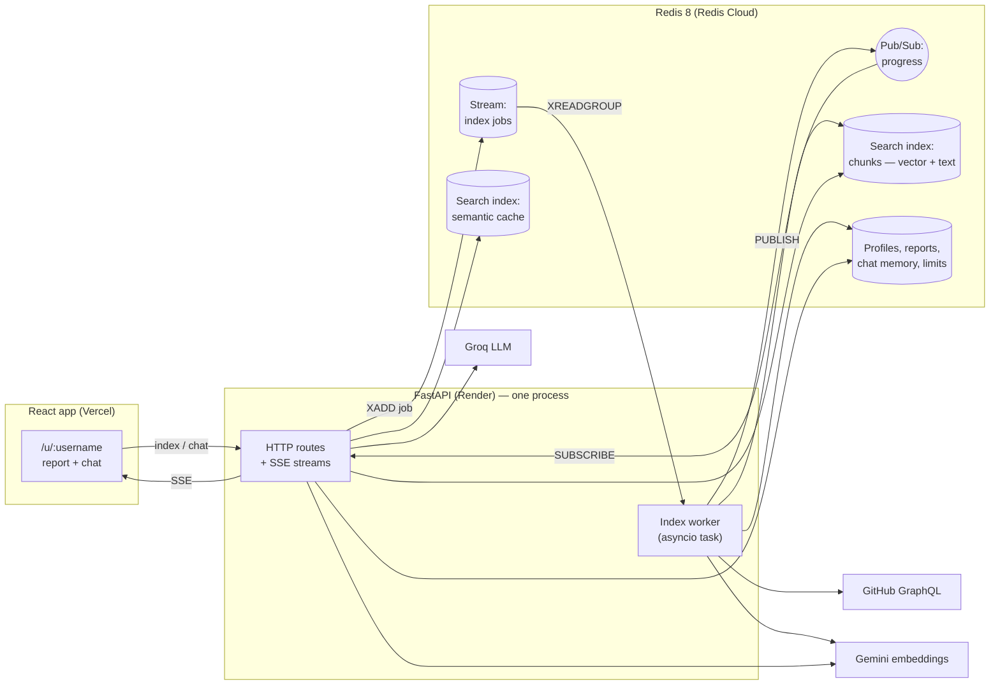
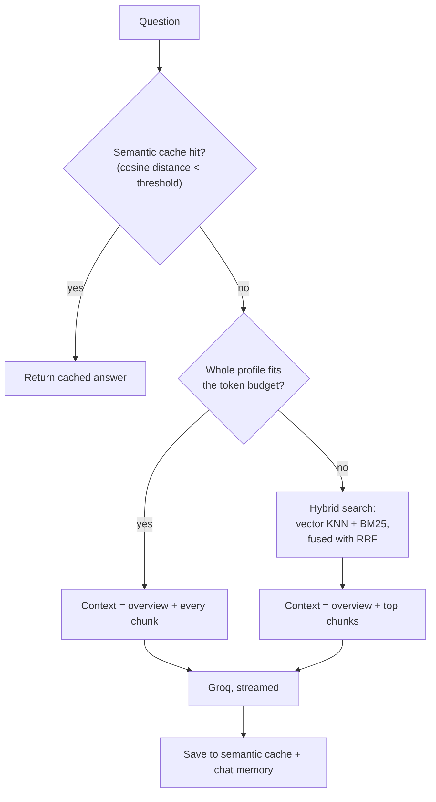

# RedisRAG v2 — Design

Status: **draft**, agreed scope as of 30 Oct 2026. This document describes what v2 will be,
why each choice was made, and in what order it gets built. It is the reference for every
v2 change: if the code and this document disagree, one of them gets fixed.

---

## 1. Goals

1. **Useful before the first question.** Indexing a profile produces a written report
   (summary, main stack, strongest projects, with evidence). Chat is the second step.
2. **Better answers.** Read more than READMEs, and pick the retrieval strategy per profile
   instead of always sending the 5 nearest chunks.
3. **Fast.** Answers stream token by token; repeated questions come from a cache;
   progress is pushed to the browser instead of polled.
4. **Redis as the whole data layer**, not just a vector store: vectors, keyword search,
   semantic cache, job queue, live progress, rate limiting and expiring caches.
5. **Defensible.** Every design decision is written down with its trade-off (section 9),
   and retrieval quality is measured, not claimed (section 6.4).

### Non-goals (for now)

- Indexing source code. Too many embedding calls and too much memory for free tiers.
- User accounts or saved history across devices.
- Private repositories.

---

## 2. Constraints

| Constraint | Effect on the design |
|---|---|
| Render free tier: one web process, 512 MB RAM, sleeps after 15 min idle | Job worker runs inside the web process; a keep-alive ping prevents sleep |
| Redis Cloud free: 30 MB, deleted after long inactivity | Every key expires; a cap on how many profiles are kept (6.6) |
| Groq free tier: tokens-per-minute limits per model | "Send everything" only when the profile fits a token budget (6.3) |
| Gemini free tier: requests-per-minute limits | Batch embeddings; never embed the same text twice (SHA cache) |
| GitHub API: GraphQL needs a token; 5,000 points/hour | `GITHUB_TOKEN` becomes required |

---

## 3. Architecture



### Backend layout

```
backend/app/
├── main.py              # app factory, lifespan (starts the worker), middleware
├── config.py            # settings (pydantic-settings)
├── api/                 # HTTP only: validate input, call a service, shape output
│   ├── profiles.py      #   index, status, report, progress stream
│   ├── chat.py          #   streaming chat
│   └── health.py
├── services/            # the logic; no FastAPI imports
│   ├── github.py        #   GraphQL fetch + manifest parsing
│   ├── chunking.py      #   Markdown-aware splitter
│   ├── embeddings.py    #   Gemini client
│   ├── indexing.py      #   the indexing job
│   ├── retrieval.py     #   router, hybrid search, fusion
│   ├── report.py        #   profile report generation
│   ├── chat.py          #   prompt building, streaming, memory
│   └── llm.py           #   Groq client
├── store/               # every Redis key lives here, nowhere else
│   ├── keys.py          #   key builders + TTLs
│   ├── vectors.py       #   index creation, upsert, search
│   ├── jobs.py          #   stream queue, locks, progress pub/sub
│   ├── cache.py         #   semantic cache
│   └── limits.py        #   rate limiting
└── schemas/             # Pydantic request/response models
```

Rules: routes never touch Redis directly; services never import FastAPI; all Redis key
strings come from `store/keys.py`. Everything is `async` (`redis.asyncio`, `httpx.AsyncClient`).

**LangChain is removed.** It was used only for `prompt | llm | parser`. The official `groq`
SDK does the same in a few lines, supports streaming directly, and is one dependency
instead of two large ones.

---

## 4. Data collected from GitHub

Two GraphQL requests per profile, instead of 17+ REST requests today.

**Request 1 — profile and repositories:** login, name, bio, avatar, followers, and for up to
100 owned, non-fork repos: name, description, URL, stars, forks, archived flag, primary
language, language breakdown (bytes per language), topics, last push date, and the file
names in the repo root.

**Request 2 — file contents** for the top repos (ranked as in 6.1), using aliases so one
request covers all of them. For each repo: the README (its real file name comes from the
root listing in request 1) and any known manifest found in the root:

| Ecosystem | Files |
|---|---|
| JavaScript / TypeScript | `package.json` |
| Python | `pyproject.toml`, `requirements.txt` |
| Go | `go.mod` |
| Rust | `Cargo.toml` |
| Java / Kotlin | `pom.xml`, `build.gradle`, `build.gradle.kts` |

**Manifests are parsed, not embedded.** A dependency list is structured data: parsing it
(with `json`, `tomllib` and simple line parsing) is free, exact, and needs no Gemini call.
The parsed dependencies go into the profile overview and the report.

---

## 5. Redis data model

| Key | Type | Holds | TTL |
|---|---|---|---|
| `profile:{u}` | JSON string | Profile, repos, languages, dependencies, corpus token count, index version | 24h |
| `report:{u}` | JSON string | Generated report (6.5) | 24h |
| `chunk:{u}:{repo}:{n}` | Hash | text, section heading, repo, username, vector | 24h |
| `sha:{u}:{repo}` | String | README blob SHA, chunk count | 24h |
| `jobs:index` | Stream | One entry per requested indexing job | trimmed to ~1,000 entries |
| `job:{u}` | Hash | status, phase, progress, error | 1h running / 24h done |
| `lock:{u}` | String | Random token of the job that owns it | 5 min, refreshed |
| `progress:{u}` | Pub/Sub channel | Progress events while a job runs | — |
| `chat:{conversation}` | List | Last 6 turns | 1h |
| `semcache:{u}:{hash}` | Hash | question, question vector, answer, sources | 24h |
| `rl:{ip}:{minute}` | Counter | Requests in this minute | 2 min |
| `profiles:recent` | Sorted set | username → last used time | — |

Search indexes:

- `idx:chunks` on `chunk:*` — `text` (TEXT, for BM25), `section` (TEXT), `username` and `repo`
  (TAG), `vector` (VECTOR, FLAT, 768 dims, COSINE).
- `idx:semcache` on `semcache:*` — `username` (TAG), `vector` (VECTOR, FLAT, 768, COSINE).

The index is created once at startup (in the lifespan hook), not checked on every request.

---

## 6. Pipelines

### 6.1 Indexing

1. `POST /profiles/{u}/index` — rate-limited. If a fresh result exists and `refresh` is false,
   return it. Otherwise take `lock:{u}` with `SET NX EX` and a random token, `XADD` a job to
   `jobs:index`, and answer `202`.
2. The worker reads jobs with `XREADGROUP`. Jobs left unacknowledged by a crashed process
   are reclaimed with `XAUTOCLAIM`, so a restart no longer loses work.
3. Fetch from GitHub (section 4). Rank repos by stars + forks, plus a small bonus for
   recent pushes; drop archived repos; keep the top 15.
4. Per repo: if the README SHA matches `sha:{u}:{repo}` and its chunks exist, skip it.
   Otherwise split it at Markdown headings (6.2), embed in batches, replace its chunks.
5. Delete chunks of repos that dropped out; refresh TTLs on the rest.
6. Generate the report (6.5), write `profile:{u}` and `report:{u}`, delete the profile's
   semantic-cache entries (old answers may now be wrong).
7. `XACK` the job, release the lock only if it still holds our token (a small Lua script,
   so check-and-delete is atomic).

Every step `PUBLISH`es a progress event on `progress:{u}`; `GET /profiles/{u}/events`
relays them to the browser as server-sent events. No polling.

### 6.2 Chunking

Split at Markdown headings first (`#`, `##`, `###`), so a chunk never mixes two sections
and carries its heading. Sections longer than the chunk size fall back to paragraph, then
sentence, then word splitting. Chunks are kept under the size limit including the overlap
(the v1 splitter could exceed it by 150 characters). Code blocks are not split mid-block
where avoidable.

### 6.3 Retrieval — choose per profile



- **Token budget** (`CONTEXT_TOKEN_BUDGET`, a setting) must stay under the Groq
  tokens-per-minute limit of the chosen model and plan. Token counts are estimated at
  indexing time and stored in `profile:{u}`.
- **Hybrid search**: run a KNN query and a BM25 full-text query on `idx:chunks`, both
  filtered to the user, then merge the two ranked lists with Reciprocal Rank Fusion
  (`score = Σ 1 / (60 + rank)`). Keyword search catches exact names ("FastAPI", "Kafka")
  that embeddings can rank low; vectors catch paraphrases.
- The profile overview (repos, languages, dependencies) is always included, so
  "list / compare" questions see every repo.

### 6.4 Evaluation

`backend/evals/` holds a small set of profiles and ~20 questions, each with the repos a
good answer must use. A script reports, per strategy (vector only, hybrid, full context):

- **retrieval hit rate** — did the expected repo appear in the context?
- **citation accuracy** — did the answer cite it?

Retrieval metrics run in CI against recorded fixtures (no API calls). Answer metrics run
on demand. Results go in the README, so the "hybrid is better" claim has numbers behind it.

### 6.5 Profile report

Generated once per indexing run with one LLM call in JSON mode, validated with a Pydantic
model (retry once on invalid JSON):

- one-paragraph summary
- primary stack (languages + frameworks, from the language breakdown and dependencies)
- 3 strongest projects, each with the reason and the evidence it came from
- notable patterns (testing, CI, documentation quality)

The report is cached for 24h, so showing a profile costs no LLM call.

### 6.6 Memory budget

Rough cost per chunk: 3 KB vector + ~1.5 KB text + index overhead ≈ 8–10 KB.
A profile is ~40–80 chunks ≈ 0.5–0.8 MB, so 30 MB holds roughly 25–40 profiles.
`profiles:recent` tracks use; when more than `MAX_PROFILES` (default 25) are stored,
the least recently used profile is deleted. TTLs remain the second safety net.

---

## 7. API

| Method | Path | Purpose |
|---|---|---|
| POST | `/profiles/{u}/index` | Start indexing (`refresh` optional) → `202` |
| GET | `/profiles/{u}` | Status, profile and report |
| GET | `/profiles/{u}/events` | Progress as server-sent events |
| POST | `/profiles/{u}/chat` | Streamed answer (SSE): tokens, then sources |
| GET | `/health` | Redis, search module, keys configured |

Rate limits (per IP): indexing 5/min, chat 20/min. Over the limit → `429` with
`Retry-After`. CORS allows only the Vercel domain and localhost.

---

## 8. Frontend

- Routes: `/` (search box + recent profiles), `/u/:username` (report + chat).
  A profile link can be shared.
- Progress via `EventSource`; chat via `fetch` reading the response stream (SSE over POST).
- Answers render Markdown as they stream; sources show repo and section.
- Mobile-first layout; report and chat stack on phones, sit side by side on desktop.
- Visual direction: calm and readable (neutral palette, one accent colour), replacing the
  current glow/glass styling.

---

## 9. Decisions and trade-offs

| Decision | Why | Trade-off accepted |
|---|---|---|
| Redis for vectors, text search, cache, queue, progress, limits | One service, already needed; TTLs fit temporary data; hybrid search in one engine | RAM-only; needs the search module (Redis 8 / Redis Cloud), not plain Redis/Valkey |
| FLAT vector index, not HNSW | Exact results; a profile has < 100 vectors, brute force is sub-millisecond | Would need HNSW at millions of vectors |
| Choose full context vs retrieval per profile | Whole-profile questions are the common case; small profiles fit | Two code paths to test |
| Hybrid search with RRF | Exact technology names matter in this domain | Two queries per question |
| Parse manifests instead of embedding them | Structured, exact, free | Only the listed ecosystems |
| Worker inside the web process, queue in a Redis Stream | Free tier has one process; the stream survives restarts and can move to a separate worker later | A busy indexing job shares CPU with requests |
| SSE instead of polling or WebSockets | One-way updates; plain HTTP; works through proxies | One open connection per watching browser |
| Drop LangChain, use the `groq` SDK | Fewer dependencies, direct streaming, easier to explain | Switching LLM provider means editing `llm.py` |
| Render free + GitHub Actions keep-alive | No new accounts, no cost | Scheduled Actions can run late, and pause after 60 days without repo activity |

---

## 10. Milestones

Each milestone ends with the site working on `main`.

A Dockerfile and `render.yaml` are left out for now: there is no Docker on the
development machine to test an image, and a Render Blueprint would create a new
service rather than adopt the running one. Revisit when the service is recreated.

### Baseline (v1.1.1, 30 Oct 2026)

Measured on the free tiers, to compare v2 against:

| Measure | v1.1.1 |
|---|---|
| Cold start (server asleep) | ~80 s |
| Chat answer, warm server, nothing streamed | 10.9 s |
| Index a 14-repo profile (141 chunks), including two Gemini rate-limit pauses | ~2 min |
| Chunks Gemini's free tier embeds before its first 429 | ~100 per minute |
| Answer cites the repo it recommends | No (example: picked `meet-translate`, cited 3 other repos) |

| # | Milestone | Done when |
|---|---|---|
| 0 | **Infrastructure** — new Redis Cloud DB, Render env vars, keep-alive workflow | `/health` reports `redis: ok` |
| 1 | **Foundation** — pinned Python and dependencies, CI running tests and build, remove dead files, then the new layout with async Redis/httpx and the `groq` SDK | CI green; v1 behaviour unchanged |
| 2 | **Collection** — GraphQL fetch, manifest parsing, Markdown chunking, profile report | Indexing a profile shows its report |
| 3 | **Retrieval** — token budget router, hybrid search, eval set | Eval numbers for all three strategies in the README |
| 4 | **Chat** — streaming, memory, semantic cache, rate limits, stream queue + SSE progress | First token in under a second on a warm server |
| 5 | **Frontend v2** — routes, report page, streaming chat, mobile layout | Works on a phone; shareable links |
| 6 | **Docs** — README, `docs/architecture.md`, `docs/deployment-lessons.md`, interview Q&A | A newcomer can run it locally from the README alone |
